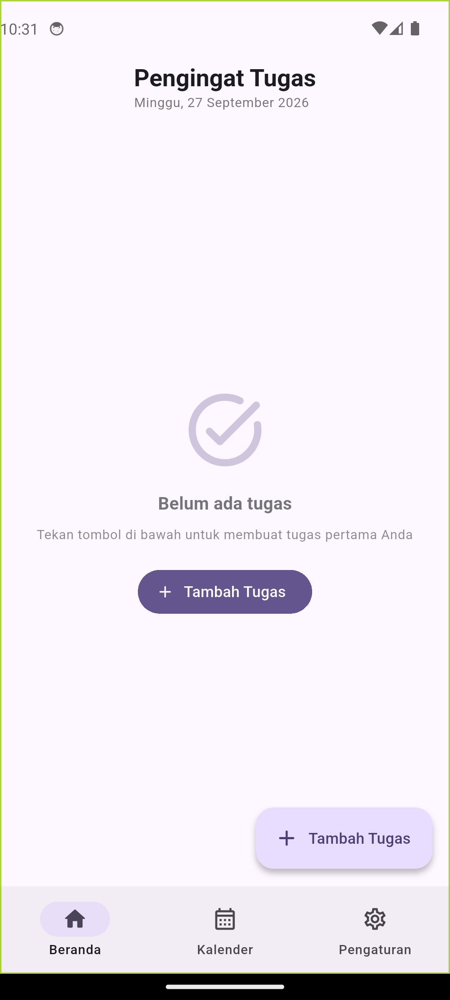
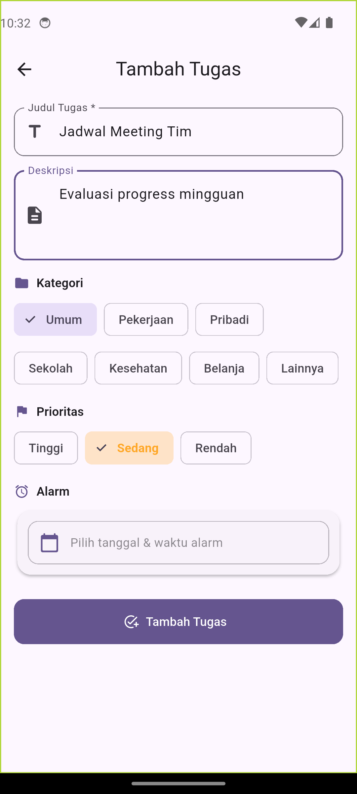
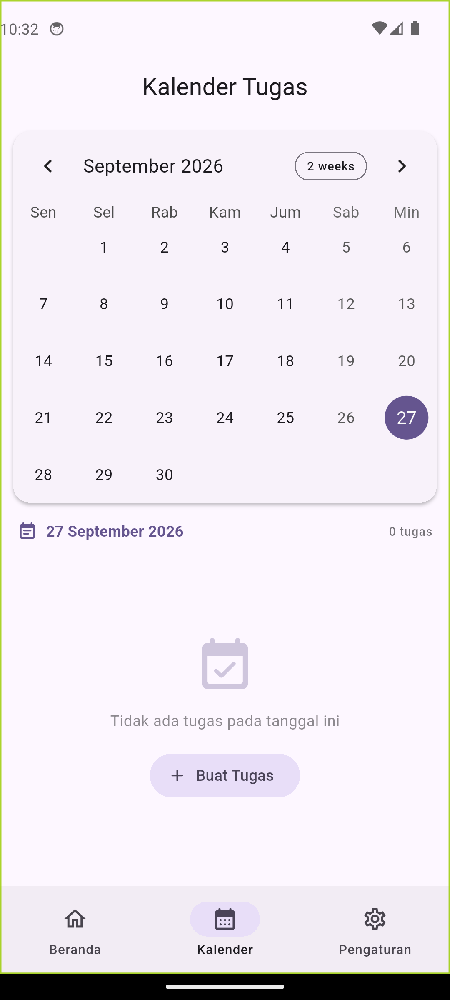

<div align="center">
  
  <h1>⏰ Pengingat Tugas (Task Reminder & Smart Alarm)</h1>
  <p><strong>Aplikasi Pengingat Tugas Harian dengan Smart Alarm Engine, Nada MP3 Kustom, Login Biometrik & Kalender Interaktif</strong></p>

  [](https://flutter.dev)
  [](https://dart.dev)
  [](#)
  [](#)
  [](#)
  [](https://pengingat-tugas-eight.vercel.app)
</div>

---

## 🌐 Live Landing Page & Download APK
Kunjungi website resmi kami untuk membaca sinopsis lengkap dan mengunduh file APK rilis:
👉 **[https://pengingat-tugas-eight.vercel.app](https://pengingat-tugas-eight.vercel.app)**

---

## 📖 Sinopsis & Latar Belakang
Di tengah padatnya aktivitas belajar, kuliah, dan pekerjaan profesional, tantangan utama yang sering dihadapi adalah lupa batas waktu (*deadline*) dan alarm pengingat yang mati akibat manajemen baterai agresif sistem Android modern.

**Pengingat Tugas** dibangun untuk menghadirkan solusi pengingat tugas yang 100% *Offline-First*, bebas iklan, aman dengan enkripsi SHA-256 + Biometrik, serta didukung oleh **Smart Alarm Engine** dengan 8 tingkat *fallback* berjenjang untuk menjamin alarm tetap berbunyi tepat waktu saat perangkat terkunci atau tidur.

---

## 🚀 Fitur Unggulan

| Fitur | Deskripsi |
|---|---|
| ⏰ **Smart Alarm Engine** | Sistem penjadwalan 8-lapis *fallback* dengan dukungan *Full Screen Intent* & *Exact Alarm*. |
| 🎵 **Nada Dering MP3 Kustom** | Personalisasi suara alarm dengan file lagu MP3 dari galeri HP dilengkapi tombol *live preview*. |
| 🔒 **Biometrik & Enkripsi** | Login cepat via Sidik Jari (Android) / Face ID (iOS) serta enkripsi password SHA-256. |
| 📅 **Kalender Visual** | Tampilan kalender interaktif bulanan berbahasa Indonesia dengan penanda titik tugas. |
| 🏷️ **Kategori & Prioritas** | Pembagian kategori (Sekolah, Kerja, Pribadi, Belanja) dan penanda warna prioritas. |
| 🌙 **Dark Mode & Material 3** | Tampilan elegan yang nyaman di mata dan hemat daya baterai AMOLED/OLED. |

---

## 📱 Tangkapan Layar (Screenshots)

<div align="center">
  
  
  
  
</div>

---

## 🏗️ Struktur Proyek (Monorepo)

```text
pengingat-tugas/
├── pengingat_tugas/            # Source code aplikasi Flutter (Android & iOS)
│   ├── android/                # Konfigurasi native Android & ProGuard
│   ├── ios/                    # Konfigurasi native iOS Xcode workspace
│   ├── lib/
│   │   ├── models/             # Hive Model: TaskModel, UserModel
│   │   ├── providers/          # State Management: Task, Auth, Theme
│   │   ├── screens/            # UI Screens: Home, Calendar, Add, Settings, Login
│   │   ├── services/           # AlarmService (8-Fallback), DatabaseService (Hive)
│   │   ├── widgets/            # TaskCard, AlarmDialog
│   │   └── main.dart           # Entry point aplikasi
│   ├── test/                   # Unit test & Widget test
│   └── pubspec.yaml            # Dependensi Flutter
├── web/                        # Landing page website (HTML, Tailwind CSS, Vercel)
│   ├── assets/                 # Screenshot HD & Ikon aplikasi
│   ├── index.html              # Landing page interaktif & audio synthesizer
│   └── vercel.json             # Konfigurasi deployment Vercel
├── .gitignore                  # Aturan git hygiene & keamanan
├── SECURITY.md                 # Kebijakan & panduan pelaporan keamanan
└── README.md                   # Dokumentasi proyek
```

---

## 🛠️ Panduan Build & Kompilasi

### Prasyarat:
- Flutter SDK (v3.24+ / v3.47+)
- Java JDK 17 atau lebih baru
- Android SDK (API 34 / 35 / 36)
- Xcode (khusus untuk kompilasi iOS di macOS)

### 1. Clone Repositori
```bash
git clone https://github.com/FallinVanjava/pengingat-tugas.apk.git
cd pengingat-tugas/pengingat_tugas
```

### 2. Pasang Dependensi
```bash
flutter pub get
```

### 3. Jalankan Pengujian Otomatis
```bash
flutter test
flutter analyze
```

### 4. Build APK Release (Android)
```bash
flutter build apk --release
```
*Hasil file binary berada di: `build/app/outputs/flutter-apk/app-release.apk`*

### 5. Build iOS Archive (macOS)
```bash
flutter build ipa --release
```

---

## 🔒 Keamanan & Privasi
Proyek ini mengimplementasikan standar keamanan ketat. Baca selengkapnya di [SECURITY.md](SECURITY.md).

---

## 👤 Pengembang
- **Nama Pengembang**: Fadhil (*FallinVanjava*)
- **Repository**: [https://github.com/FallinVanjava/pengingat-tugas.apk](https://github.com/FallinVanjava/pengingat-tugas.apk)
- **Email**: `fadhilwae73@gmail.com`

---
*© 2026 Pengingat Tugas. Hak Cipta Dilindungi Undang-Undang.*
